# BarberShop do Gui — agendamento online, painel da equipe e BI

Sistema web para uma **barbearia de bairro real**: o cliente reserva horário sem criar conta, e a equipe passa a enxergar agenda, estoque e indicadores num só lugar.

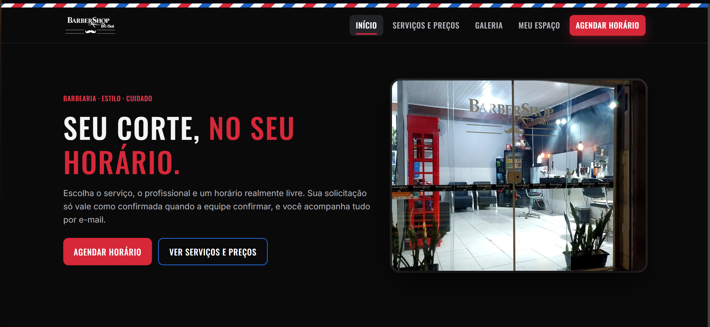

## O problema

Barbearia pequena costuma agendar por mensagem e caderno. Isso gera três dores concretas:

- **Conflito de horário:** dois pedidos para o mesmo profissional no mesmo intervalo, ou um corte longo que invade o horário seguinte.
- **Sem visão do negócio:** não dá para saber qual é o dia mais cheio, o horário de pico, qual serviço dá mais receita ou quantos pedidos são cancelados.
- **Dados pessoais soltos:** nomes e telefones em conversas e papéis, sem como apagar a pedido do cliente (LGPD).

## Para quem

| Quem | O que ganha |
|---|---|
| **Cliente** | Escolhe serviço, profissional e horário livre em poucos passos. Sem senha: um link enviado por e-mail confirma o pedido e abre o espaço dele. |
| **Recepção** | Agenda do dia/semana, agendamento no balcão para cliente sem cadastro, estoque e equipe. Não vê financeiro nem BI. |
| **Proprietário** | Tudo isso, mais BI, receita por serviço e por profissional, bloqueios de agenda, usuários e auditoria. |

## Como funciona

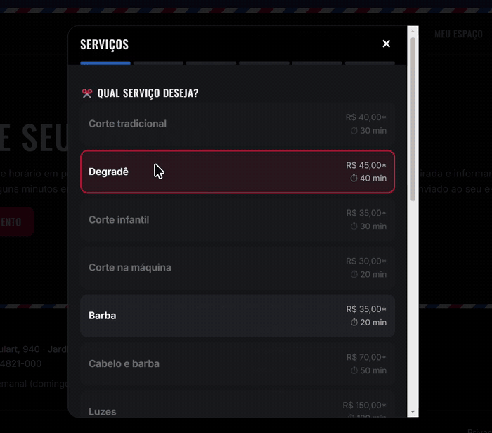
*Fluxo do cliente: serviços, profissional e horário, produtos e resumo do pedido (a etapa de dados pessoais foi omitida).*

1. O cliente escolhe serviço, profissional e data; o sistema mostra **só horários livres**, considerando duração, pausas, bloqueios e outros agendamentos.
2. O horário fica **reservado por 10 minutos** enquanto ele preenche os dados.
3. O pedido nasce como **SOLICITADO** e o cliente recebe um link mágico (vale 30 min) que **confirma** o horário. Sem confirmar, o horário é liberado.
4. A equipe acompanha, confirma, dá baixa ou cancela.

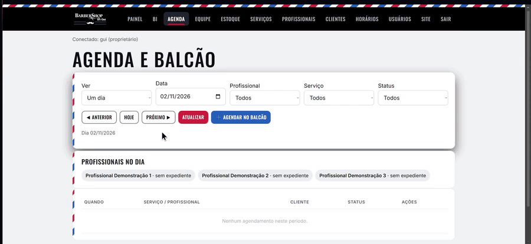
*Área da equipe: agenda por dia e por semana, filtros e ações.*

## Dados e BI

O mesmo banco alimenta o painel de BI do sistema e um pipeline Python/Pandas com relatório de qualidade, medidas DAX e roteiro de Power BI. Os indicadores mostram dia mais cheio, horário de pico, situação dos pedidos e receita por serviço e por profissional.

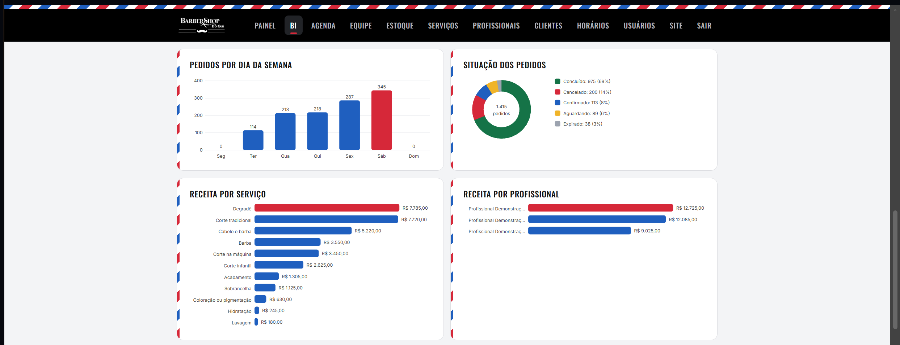
*Painel de BI com dados simulados: pedidos, situação e receita por serviço e profissional.*

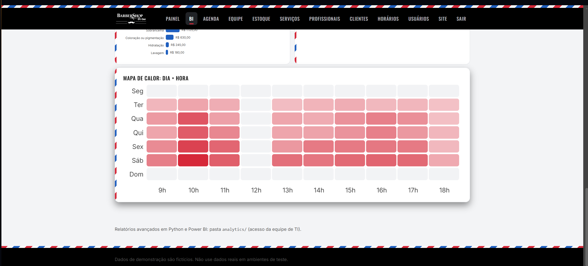
*Mapa de calor de pedidos por dia da semana e horário.*

A exportação CSV **não contém dados pessoais**:

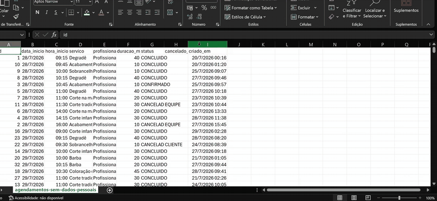

> Valores em R$ são o **preço de tabela dos atendimentos concluídos** (não há registro de pagamento) e só aparecem para o proprietário.

## Por que estas tecnologias

| Decisão | Motivo |
|---|---|
| **PostgreSQL com `EXCLUDE USING gist`** | O anti-conflito fica no banco, não só no código: mesmo com duas requisições simultâneas, intervalos sobrepostos são recusados. Checagem amigável adicional no serviço. |
| **Spring Boot + JDBC puro (`JdbcTemplate`)** | O SQL é o centro do problema (disponibilidade, sobreposição, views analíticas). JDBC mantém a consulta visível e parametrizada. |
| **Regras puras em `model/`, sem framework** | Transições de status e cálculo de horários livres são testáveis isoladamente com JUnit. |
| **HTML/CSS/JS puro, sem SPA** | Permite CSP restritiva (sem script ou estilo inline) e reduz a superfície do front. |
| **Cliente sem senha (link de uso único)** | Barbearia tem cliente eventual; senha seria atrito e mais um dado a proteger. Token aleatório, só o hash fica no banco. |
| **Python/Pandas + Power BI sobre views sem dados pessoais** | Separa análise de operação e mantém a LGPD: o BI nunca toca nome, e-mail ou telefone. |

Detalhes e limites: [arquitetura](docs/arquitetura.md) · [limitações](docs/limitacoes.md).

## Segurança e LGPD

Admin com BCrypt, bloqueio por tentativas, CSRF e CSP. O cliente pode excluir a própria conta; a exclusão remove os dados pessoais e mantém só o histórico anônimo para os indicadores.

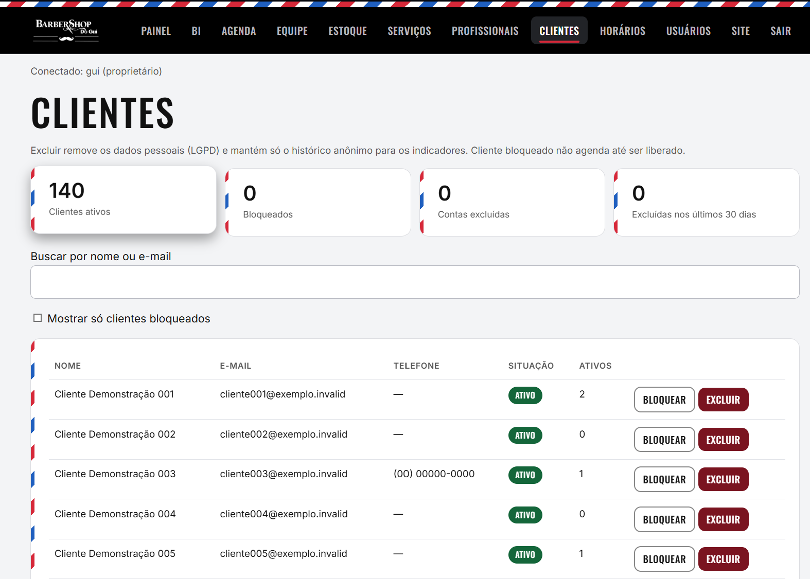

## Equipe

Projeto acadêmico em grupo, desenvolvido para uma barbearia real. Começou no primeiro semestre com HTML, CSS, Bootstrap e JavaScript e foi remodelado com Java, Python, SQL, Analytics e BI.

| Integrante | Frente |
|---|---|
| [Max Godoy](https://github.com/maxgodoydev) | Dados, Analytics e BI: Python/Pandas, SQL analítico, Power BI e DAX |
| [Luca](https://github.com/Luck16Ash) | Backend Java: agendamento, disponibilidade, reservas, acesso do cliente e site público |
| [Alexandre](https://github.com/alexandregial-cmd) | Backend Java: base da aplicação, administração, segurança, estoque e indicadores, Dockerfile |

Detalhes em [`docs/equipe.md`](docs/equipe.md).

## Mais capturas

Todos os dados das imagens são **fictícios** (clientes "Demonstração NNN", e-mails `.invalid`). Legendas completas em [`docs/images/LEGENDAS.md`](docs/images/LEGENDAS.md).

| | |
|---|---|
| 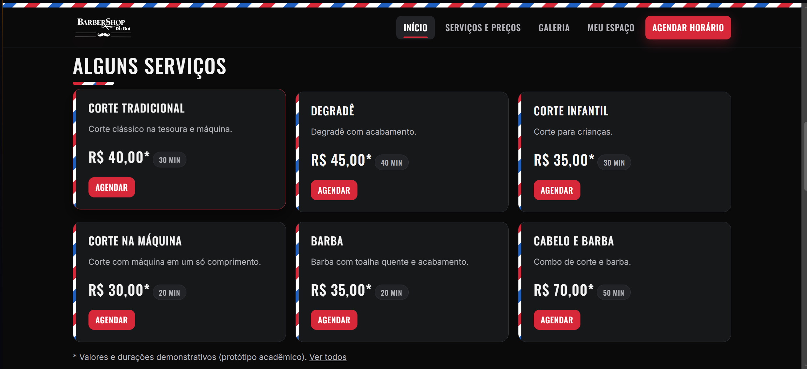 | 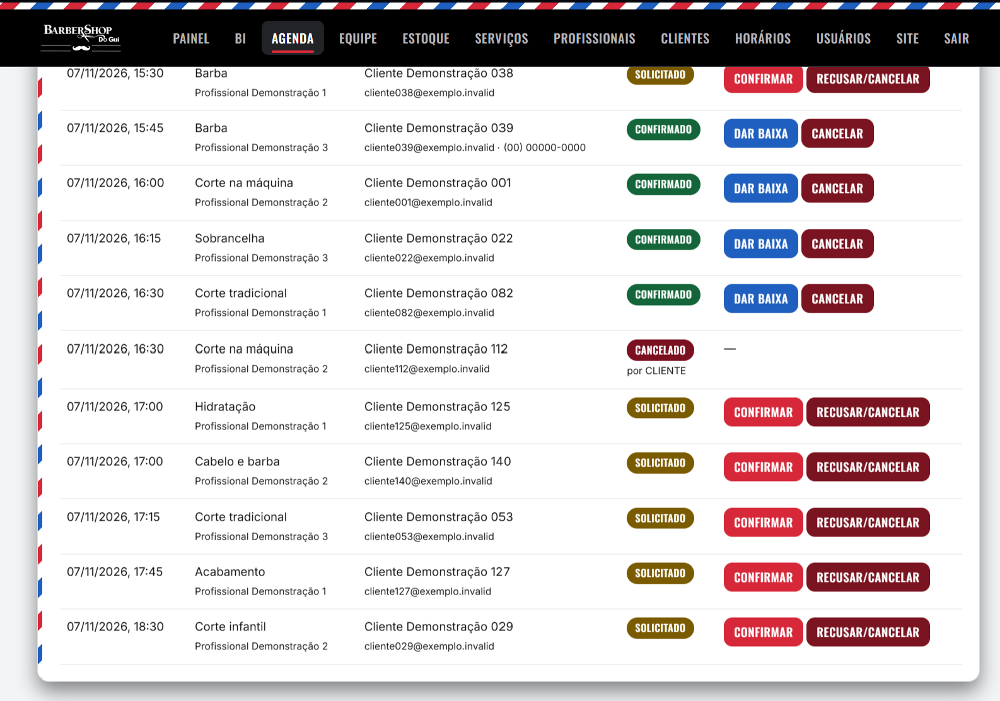 |
| Catálogo público com duração e preço de referência | Pedidos: Solicitado, Confirmado e Cancelado |
| 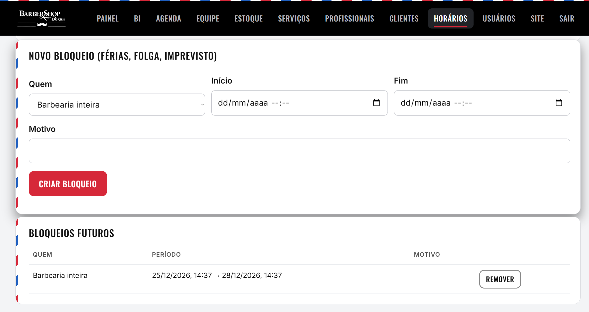 | 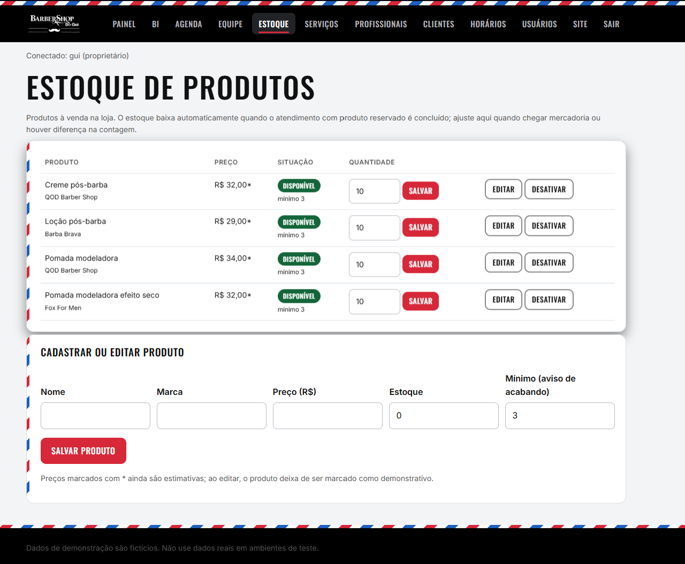 |
| Bloqueios (férias, folga, imprevisto) | Estoque com mínimo e cadastro |
| 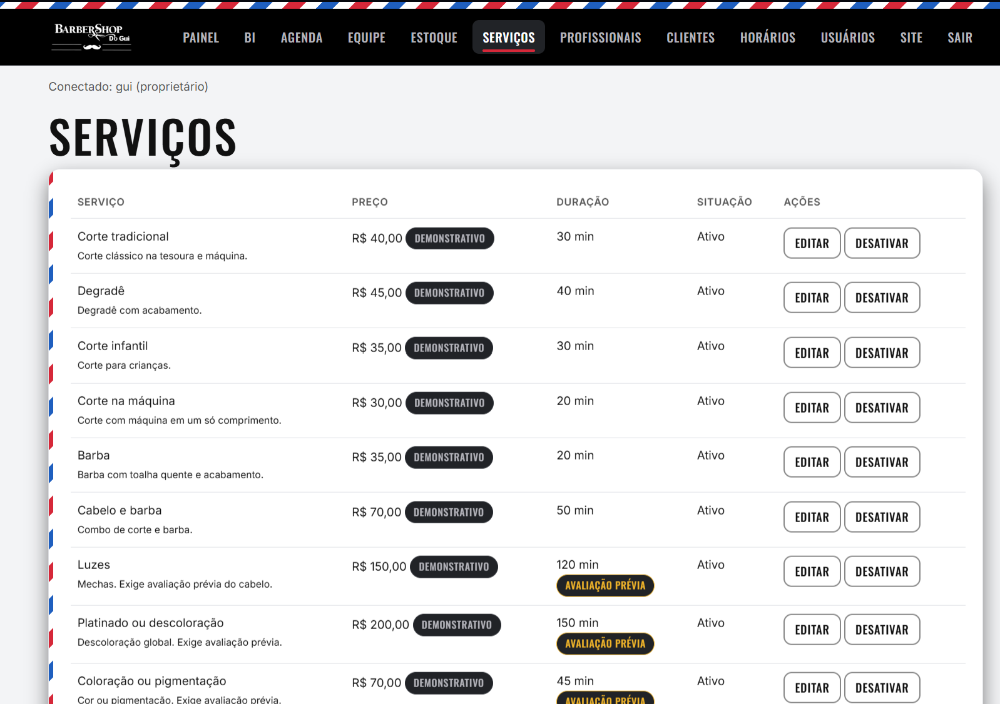 | 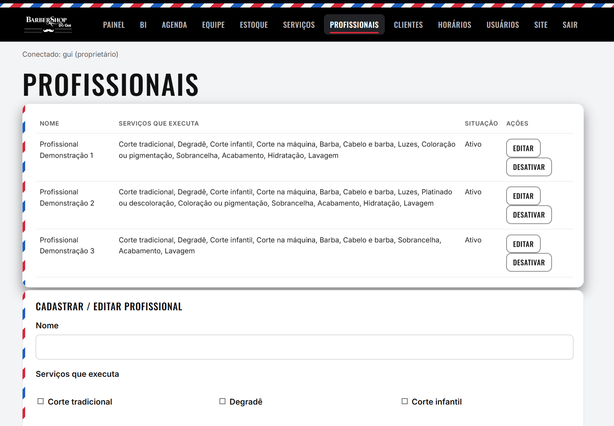 |
| Gestão de serviços | Profissionais e serviços que executam |

> **Estado atual:** as capturas foram feitas com o sistema rodando localmente e dados de demonstração. O SQL, os testes de banco, o pipeline Python e a sintaxe do front são verificados em PostgreSQL 16 na CI (`.github/workflows/verify.yml`). O resultado do `mvn verify` aparece na aba *Actions* (ver [`docs/testes.md`](docs/testes.md)). Preços, durações e horários são **estimativas do protótipo**, não os oficiais. Nenhum deploy foi realizado.

---

## Funcionalidades (referência técnica)
- Catálogo de serviços (preço, duração, ativação, aviso de avaliação prévia para procedimentos químicos) e 3 profissionais com agenda própria (janelas, pausas, bloqueios/férias).
- Agendamento: escolha de serviço/profissional/data → só horários livres (considera duração, pausas, bloqueios, outros agendamentos) → **reserva de 10 min** → dados → pedido **SOLICITADO** → o cliente abre o **link mágico** do e-mail (vale 30 min), que **confirma o horário e já abre o espaço dele, sem senha** (sem confirmar, o horário é liberado).
- Anti-conflito no banco (`EXCLUDE USING gist`) e no servidor; sobreposição de intervalos, não só horário idêntico.
- Cliente **sem senha**: link de uso único por e-mail (token aleatório, hash no banco, expira em 15 min; o link de confirmação vale 30 min). Modo dev claramente identificado quando não há SMTP.
- Admin com contas individuais (proprietário, recepção e técnico; ver *Perfis de acesso*), BCrypt, bloqueio por tentativas, CSRF, CSP; agenda com filtros e mudança de status validada; serviços, profissionais, horários, bloqueios, usuários; painel de indicadores; CSV sem dados pessoais.
- Dados: consultas em `database/queries/`, pipeline com relatório de qualidade, medidas DAX e roteiro do relatório Power BI. Valores em R$ são **preço de tabela dos atendimentos concluídos** (não há registro de pagamento) e só aparecem para o proprietário.

## Estrutura
```
app/         Spring Boot (src/main/java, resources/static = front multipágina), testes JUnit
database/    schema.sql · analytics_views.sql · seed_demo.sql · migracoes/ (004–009) · aplicar.sh · queries/ · tests/
analytics/   barbershop_analytics/ (pipeline) · tests/ · sample_data/ · powerbi/ (DAX, M, layout) · output/ (gerado)
scripts/     gerar_dados_demo.py · check_project.py · verifica_banco.py · rodar-local.*
docs/        arquitetura, modelo-de-dados, regras-de-agendamento, api, seguranca, metricas, pipeline-de-dados, powerbi, deploy, testes, limitacoes (+ documentos acadêmicos originais: PMC, entrevista, planejamento, protótipo)
```

## Executar localmente
**Sem instalar banco (recomendado para testar):** Postgres embutido, perfil `local` (só JDK 21+ e Maven). Aplica schema, views, seed e migrações 004–009 sozinho; dados descartados a cada execução.
```powershell
cd app
$env:BOOTSTRAP_OWNER_USERNAME = "gui"; $env:BOOTSTRAP_OWNER_PASSWORD = "uma-senha-com-12+"
mvn spring-boot:run "-Dspring-boot.run.profiles=local"      # http://localhost:8080
```
**Com PostgreSQL instalado** (`database/aplicar.sh` aplica, nesta ordem: `schema`, `analytics_views`, `seed_demo` (opcional), as migrações `004_etapa4`, `005_exclusao_e_supabase`, `006_bi`, `007_etapa4b`, `008_perfis_balcao` e `009_regras_servicos` e, por último, `seed_demo_produtos` (opcional, depende da 004)):
Requisitos: JDK 21, Maven 3.9+, PostgreSQL 15+ (com `btree_gist`), Python 3.11+.
```bash
createdb barbershop_gui
PGDATABASE=barbershop_gui database/aplicar.sh --demo     # --demo inclui dados fictícios; em produção rode sem ele
python3 scripts/verifica_banco.py                         # opcional: confere as regras do banco (mesmo teste da CI)
export DB_URL=jdbc:postgresql://localhost:5432/barbershop_gui DB_USERNAME=<usuario> DB_PASSWORD=<senha>
export BOOTSTRAP_OWNER_USERNAME=<seu-usuario> BOOTSTRAP_OWNER_PASSWORD=<12+ caracteres>   # cria o proprietário só se não houver usuários
cd app && mvn test && mvn spring-boot:run          # http://localhost:8080
```
Atalho: `scripts/rodar-local.ps1` (Windows) ou `scripts/rodar-local.sh` (Linux/macOS) fazem os passos acima de forma interativa.
Admin: `http://localhost:8080/admin-login.html`. Sem senha padrão; contas técnicas são criadas pelo proprietário em *Usuários*. Com `MAIL_MODE=dev` (padrão) nenhum e-mail é enviado: o link de consulta do cliente aparece no log do servidor. Variáveis completas: [`.env.example`](.env.example).

## Executar o pipeline de dados e BI
```bash
cd analytics && pip install -r requirements.txt
python -m barbershop_analytics --input sample_data --output output --agora 2026-10-24T12:00:00   # ou --source postgres
python -m unittest discover -s tests -v
```
Power BI: siga [`analytics/powerbi/modelo-e-layout.md`](analytics/powerbi/modelo-e-layout.md) (não há `.pbix`).

## Documentação
[arquitetura](docs/arquitetura.md) · [modelo de dados](docs/modelo-de-dados.md) · [regras de agendamento](docs/regras-de-agendamento.md) · [API](docs/api.md) · [segurança/LGPD](docs/seguranca.md) · [métricas](docs/metricas.md) · [pipeline](docs/pipeline-de-dados.md) · [Power BI](docs/powerbi.md) · [deploy](docs/deploy.md) · [testes](docs/testes.md) · [limitações](docs/limitacoes.md)

## Pendências que dependem de você
Compilar/rodar `mvn verify` e corrigir eventuais erros; executar os SQLs em PostgreSQL; configurar SMTP; informar endereço/telefone/horários/preços reais (`SHOP_*`, tela de serviços); montar o `.pbix`; revisão da política de privacidade; ajustar a seção de equipe com as contribuições reais.

## Licença e créditos
Código sob MIT (`LICENSE`). Marca, logo e fotos pertencem à BarberShop do Gui e são usados com autorização do proprietário. Equipe: ver [`docs/equipe.md`](docs/equipe.md). Desenvolvido com apoio de IA generativa, declarado conforme as regras acadêmicas.

## Protótipo visual multipágina
`prototipo/` (HTML/CSS/JS estático, abra `index.html`): início, serviços, galeria com fotos reais ampliáveis, horários/regras e agendamento em pop-up por etapas; `prototipo/pmc.html` é o PMC estilizado. Preços, profissionais e disponibilidade são **simulados**.


## Produção
Use `SPRING_PROFILES_ACTIVE=prod` (cookie `Secure` e IP real atrás de proxy por padrão) e siga [`docs/deploy.md`](docs/deploy.md).

## Perfis de acesso (etapa 5)
| Perfil | Login | O que acessa |
|---|---|---|
| Cliente | link mágico no e-mail, **sem senha** | seus dados, agendamentos e produtos (futuros, concluídos, cancelados), cancelar e excluir a própria conta |
| Recepção (atendimento) | usuário e senha | agenda do dia/semana/mês, **agendamento no balcão** (cliente sem cadastro), equipe (disponibilidade e atendimentos por profissional), estoque, clientes (sem bloquear/excluir). **Sem** BI, dashboards nem financeiro |
| Proprietário (Gui) | usuário e senha | tudo: BI, valores por profissional (semana/mês), clientes bloqueados/excluídos, usuários, horários, catálogo, auditoria |
| Equipe técnica (dev) | usuário e senha | indicadores agregados, catálogo e clientes com dados mascarados |
| Profissionais | **não têm conta** | acompanhados pelo proprietário e pela recepção |
